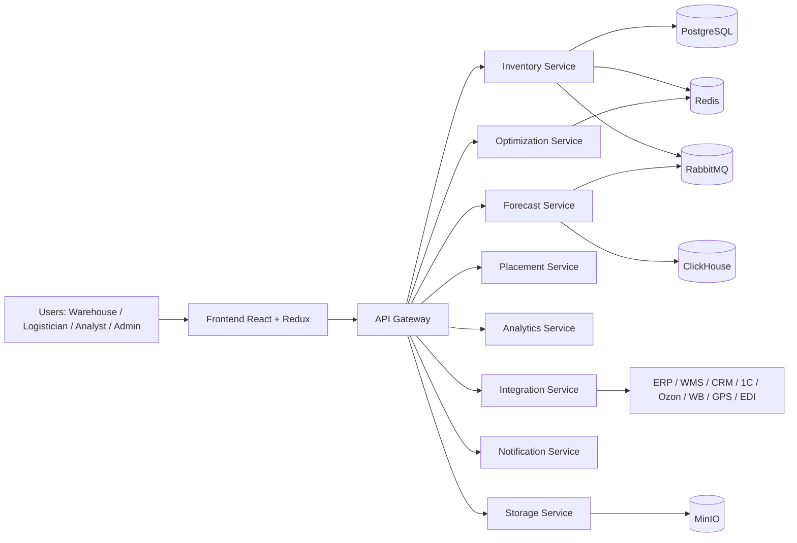

# SmartStock Architecture

## 1) High-level architecture



## 2) Core data flow (inventory lifecycle)

```mermaid
sequenceDiagram
    autonumber
    participant C as Scanner/RFID
    participant GW as API Gateway
    participant INV as Inventory Service
    participant FC as Forecast Service
    participant OPT as Optimization Service
    participant NTF as Notification Service
    participant STG as Storage Service

    C->>GW: new shipment / shipment event
    GW->>INV: register movement (FIFO/FEFO)
    INV-->>GW: movement_id + updated_skus
    GW->>FC: forecast recalculation (7/30 days)
    FC-->>GW: forecast + anomalies
    GW->>OPT: reorder and safety stock
    OPT-->>GW: recommendations + dynamic price
    GW->>NTF: notify about deficit/overstock/expiry
    GW->>STG: persist audit trail
```

## 3) Data storage strategy

- `PostgreSQL`: operational records (movements, reorder policies, user/role references).
- `ClickHouse`: analytical aggregates (MAPE trend, turnover, spoilage, KPI time-series).
- `Redis`: low-latency cache for stock balances and recent forecast snapshots.
- `MinIO`: document metadata and binary artifacts (contracts, invoices, media).
- `RabbitMQ`: async event exchange between movement capture and downstream processors.

## 4) Security model

- Role-based access: `warehouse_worker`, `logistician`, `analyst`, `admin`.
- Sensitive values (counterparty/price) are encrypted before persistent storage.
- Audit events are generated for policy changes and inventory operations.
- API gateway is the external entrypoint; internal service network is isolated by docker network.

## 5) Selected optional enhancements (implemented)

1. Dynamic pricing based on demand and stock coverage (Group A-1).
2. Automatic anomaly detection in demand history (Group A-3).
3. GPS/GLONASS connector endpoint in integration-service (Group B-1).
4. 1C connector endpoint in integration-service (Group B-3).
5. Parallel scanner stream processing in inventory-service (Group C-1).
6. Redis-ready cache-oriented design for frequently requested stock (Group C-2).
7. Role-custom dashboards (Group D-2).
